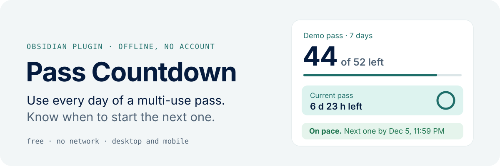
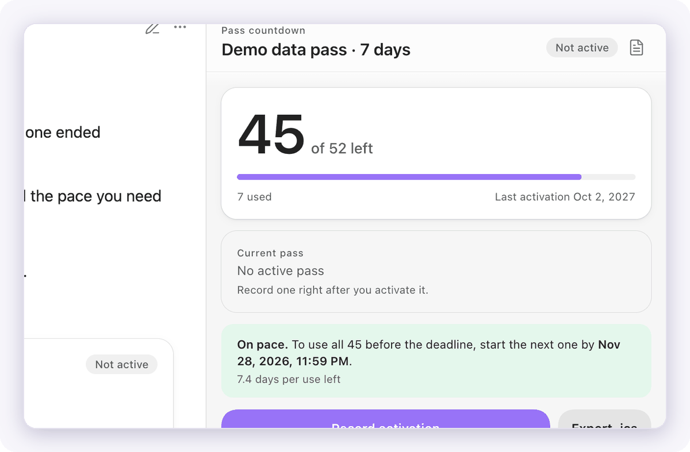
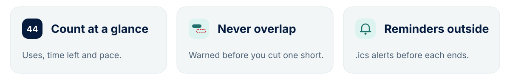
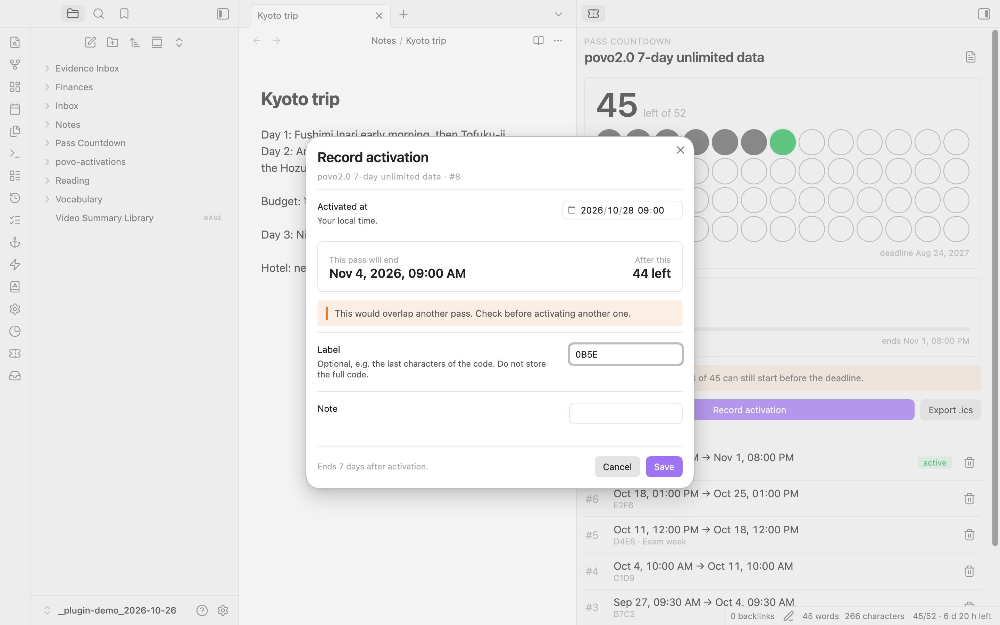
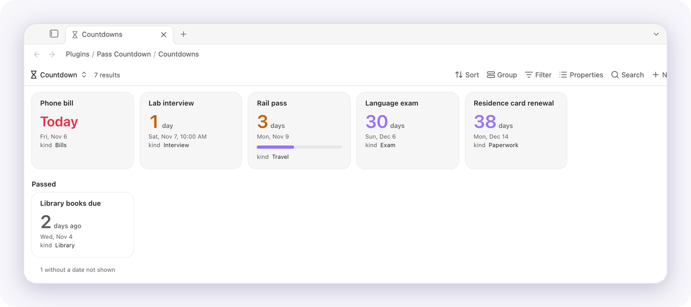
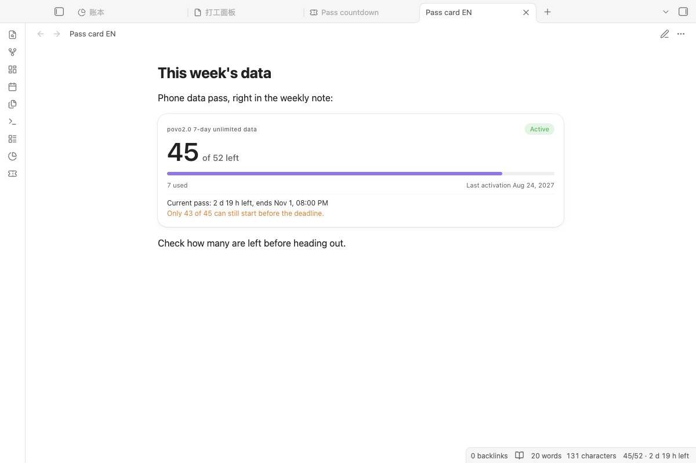

<p align="right"><a href="README.md">English</a> · <a href="README.zh.md">中文</a></p>

<p align="center"><picture><source media="(prefers-color-scheme: dark)" srcset="assets/readme/icon-dark.svg"></picture></p>

<picture>
  <source media="(prefers-color-scheme: dark)" srcset="assets/readme/hero-dark.svg">
  
</picture>

<p align="center"><a href="https://community.obsidian.md/plugins/pass-countdown"><b>Obsidian からインストール</b></a></p>

<picture>
  <source media="(prefers-color-scheme: dark)" srcset="assets/readme/demo-dark.gif">
  
</picture>

<picture>
  <source media="(prefers-color-scheme: dark)" srcset="assets/readme/cards-dark.svg">
  
</picture>

## 3 ステップで始める

1. 「設定 → コミュニティプラグイン → 閲覧」で **Pass Countdown** をインストールして有効にし、左のリボンにあるチケットのアイコンを押します。
2. **「Settings → Pass Countdown」** で名前、総回数、1 回の日数、期限を設定します。
3. 券を使い始めたら、**「Record activation」** を押し、開始時刻を確認して保存します。

まだ券がない場合は、空のパネルで **「Load a sample」** を押すと試せます。

**動作環境** Obsidian 1.10 以降。デスクトップとモバイルに対応しています。**費用** 無料です。アカウントやキーは不要で、ネットワーク通信は行いません。

うまく動かないときは、[AI アシスタントに貼る確認用プロンプト](docs/troubleshooting.ja.md)をどうぞ。

## その他

<details>
<summary><b>初回の使い方</b></summary>

1. **Pass Countdown** をインストールして有効にし、左のリボンにあるチケットのアイコンを押します。
2. 記録がない状態で **「Load a sample」** を押すと、架空の券でカウントダウン、リング、利用ペースを確認できます。サンプルは書き出しと通知の対象外です。**「Remove sample」** を押すとサンプルの記録を削除します。
3. **「Settings → Pass Countdown」** で名前、総回数、1 回の日数、期限を設定します。
4. 券を使い始めたら、**「Record activation」** を押し、開始時刻を確認して保存します。

</details>

<details>
<summary><b>機能一覧</b></summary>



*保存前に終了時刻、残り回数、現在の券と重なるかを確認できます。*

- **利用開始の記録：** 「N 回分、1 回 D 日間、開始期限あり」というプリペイド券の利用回数を記録します。サービス側で使用済み回数を確認できなくても、パネルで残り回数を計算できます。
- **重複の警告：** 新しい券が現在の券と重なる場合に警告します。期限前にすべて使うためのペースも計算します。
- **終了前の通知：** Obsidian 内の通知と、カレンダー用の .ics 書き出しに対応しています。
- **パネル：** 残り回数、現在の券の残り時間、期限までの日数、利用ペースを表示します。残りを続けて使い切るための次回開始の最終時刻を計算し、間に合わない場合はあと何回使えるかを表示します。
- **ステータスバー：** `47/52 · 3 d 4 h left` のように表示します。
- **カレンダー通知：** 券ごとにイベントと終了前のアラームを含む `.ics` ファイルを書き出します。初期設定は終了 12 時間前、1 時間前、終了時です。Apple カレンダー、Google カレンダー、Outlook に取り込めます。
- **Obsidian 内の通知：** 現在の券の終了が近づいたときと、すべて使い切れる次回開始の最終時刻が近づいたときに、それぞれ 1 回通知します。
- **Bases のカウントダウン表示：** base のビューを **「Countdown」** にすると、ノートごとに日付プロパティまでの残り日数を表示します。締め切り、試験、在留資格の更新日などに使えます。既定では近い日付から並び、過ぎた日付は下に表示します。base で指定した並び順も保持します。開始日のプロパティを選ぶと進捗を表示します。Bases が無効でも、通常の券の機能は使えます。
- **Markdown レポート：** 利用開始の全記録を書き出せます。`activated_at` / `expires_at` の frontmatter があるノートからの取り込みと、入力を間違えた記録の編集にも対応しています。

<picture>
  <source media="(prefers-color-scheme: dark)" srcset="assets/readme/bases-dark.png">
  
</picture>



*ノートに `pass-countdown` コードブロックを入れると、同じカウントを表示します。1 分ごとに更新します。*

このプラグインは、日本の povo2.0 の 7 日間データ使い放題 52 回分（2027 年 8 月 24 日までに利用開始）を数えるために作られました。同じ仕組みのジム利用券、回数券、試用期間にも使えます。

</details>

<details>
<summary><b>データの保存先と読み書きする範囲</b></summary>

| 項目 | 内容 |
|---|---|
| Obsidian | 1.10 以降、デスクトップとモバイルに対応します。1.8.7–1.9.x では 1.4.1 を使います。 |
| プラグイン | 無料、MIT ライセンスです。 |
| 通信 | ネットワーク通信は行いません。アカウントやキーは不要です。 |

記録は外部に送信せず、保管庫内のこのプラグインの `data.json` に保存します。レポートと `.ics` は指定した場所に書き出します。必要なら短いラベルだけを保存し、引き換えコード全体は保存しないでください。

- **読み取り：** このプラグインの `data.json` を読みます。データがない初回起動時だけ、旧プラグイン `povo-7day-tracker` の `data.json` があれば読み取ります。取り込みを実行したときは、指定フォルダーのノートの frontmatter を読みます。Bases の Countdown ビューでは、現在の base に含まれるノートの日付と表示用プロパティを読みます。
- **書き込み：** このプラグインの `data.json` に保存します。書き出し時は、設定した場所にレポートと `.ics` を保存します。初期設定は `Pass Countdown/report.md` と `Pass Countdown/reminders.ics` です。どちらも保管庫内のパスで、同名ファイルは上書きします。**「Insert pass card into the current note」** は、カーソル位置にコードブロックを挿入するか、選択中の内容を置き換えます。
- **行わない操作：** ネットワーク通信、クリップボードの使用、外部プログラムの実行、保管庫外の読み書きは行いません。

</details>

<details>
<summary><b>手動インストールと設定例</b></summary>

**Obsidian から：** 「設定 → コミュニティプラグイン → 閲覧」で **Pass Countdown** を検索します。[PKMer は公式ディレクトリを自動同期します](https://pkmer.cn/Pkmer-Docs/00-%E5%85%B3%E4%BA%8E/pkmer%E7%A4%BE%E5%8C%BAfaq/)。

**手動：** [最新リリース](https://github.com/Rexxall/obsidian-pass-countdown/releases/latest)から `main.js`、`manifest.json`、`styles.css` をダウンロードし、`<vault>/.obsidian/plugins/pass-countdown/` に置きます。Obsidian を再読み込みして有効にします。

**ダウンロードの検証：** 1.4.1 以降は、GitHub Actions で配布ファイルをビルドし、署名付きのビルド来歴証明を付けています。`gh attestation verify main.js --repo Rexxall/obsidian-pass-countdown` で検証できます。

**設定例：povo2.0 の 7 日間データ 52 回分。** 初期設定は 52 回、1 回 7 日間、期限は `2027-08-24T23:59:00+09:00` です。実際の条件は自分の購入記録で確認してください。

</details>

<details>
<summary><b>計算の仕組み</b></summary>

- 時刻は UTC で保存し、端末の現地時刻で表示します。移動やシステムのタイムゾーン変更で券の有効期間は変わりません。
- **期限** は、初期設定では利用開始できる最終時刻です。期限直前に開始した券も、設定した日数だけ使えます。期限までに使い終える必要がある場合は、設定の **「The deadline is」** を変更します。開始できる時刻が、券 1 回分の日数だけ早まります。
- *次回開始の最終時刻* = 期限 −（残り回数 − 1）× 1 回の日数です。すべての券を期限までに開始できないときは、利用ペースがオレンジ色になります。

</details>

<details>
<summary><b>制限</b></summary>

- 一つの保管庫で管理できる券の種類は一つです。
- スマートフォンへの通知は、`.ics` を取り込んだカレンダーから届きます。新しい利用開始を記録したら、再度書き出してください。
- Obsidian 内の通知は、Obsidian が開いている間だけ表示します。

</details>

<details>
<summary><b>開発と変更履歴</b></summary>

```bash
npm install
npm run build
npm test   # 終了時刻、ペース、重複、.ics、レポートのエスケープ、取り込み、編集、通知、移行
```

`styles.css` は生成ファイルです。`styles/plugin.css` を編集し、`npm run styles` を実行します。CI、リリース、不具合報告については [CONTRIBUTING.md](CONTRIBUTING.md) を参照してください。

**1.5.0：** Bases 用の Countdown ビューを追加しました。ノートごとに日付プロパティまでの残り日数を表示します。Obsidian 1.10 が必要です。

**1.4.0：** 外観を変えずに、コミュニティディレクトリの自動審査の指摘に対応しました。

**1.3.0：** 空のパネルにサンプル読み込みを追加しました。Obsidian の `getLanguage()` で表示言語を判断するようにし、英語と中国語の README を用意しました。全履歴は [CHANGELOG.md](CHANGELOG.md) を参照してください。

</details>

MIT ライセンス
