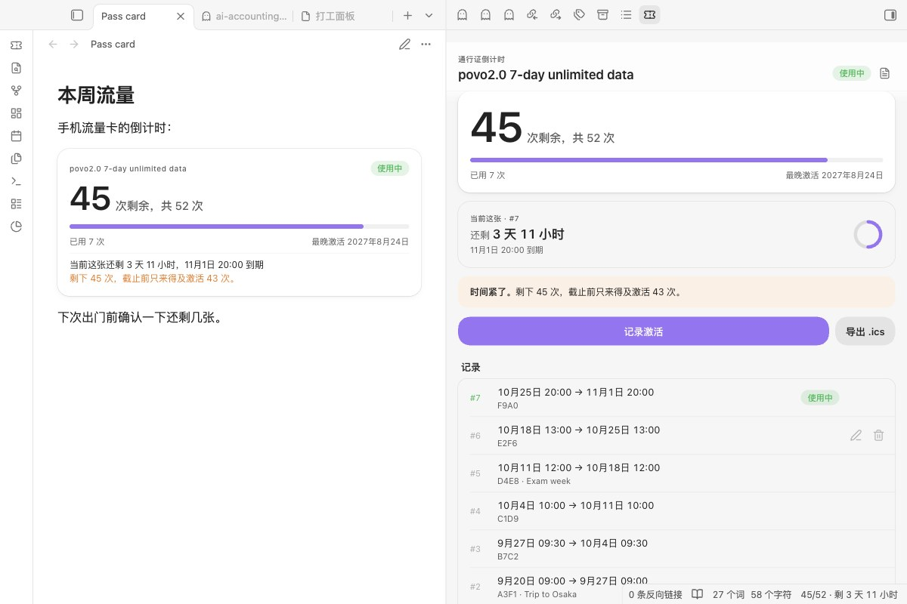
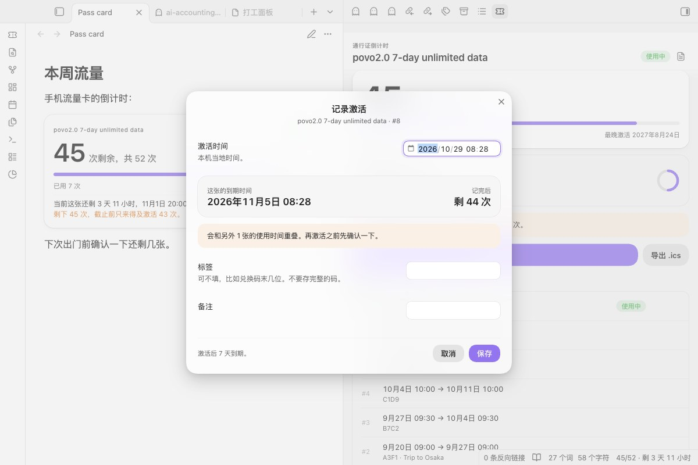

<div align="center">

# Pass Countdown

**Count down a multi-use pass: uses left, time left on the current one, and whether you can still use them all before the deadline.**

多次券倒数：还剩几次、这一张还剩多久、按现在的节奏能不能在期限前用完。

[Features](#features) · [Install](#install) · [Privacy](#privacy) · [中文说明](#中文说明) · [日本語](#日本語)

<picture>
  <source media="(prefers-color-scheme: dark)" srcset="docs/screenshots/panel-dark.jpg">
  
</picture>

</div>

## Why

Some prepaid bundles give you a number of uses, each lasting a fixed time, and a last date to activate them. The one that started this plugin is a Japanese mobile data bundle: one prepaid code good for 52 uses of 7-day unlimited data, to be entered by 24 August 2027. The provider says the number of uses cannot be checked and asks you to keep count yourself, and it is easy to waste days or to start a new pass while the old one is still running.

Pass Countdown keeps that count in Obsidian. It works for any pass with the same shape: gym visits that expire, ticket books, trial periods.

## Features

- **Record an activation** with its start time (defaults to now) and an optional label. The end time is worked out for you.
- **Overlap warning** if the pass you are about to record would run at the same time as one that is still active.
- **Dashboard:** uses left, time left on the current pass, days to the deadline, and **pace**: how many days you have per remaining use, and the latest moment to start the next pass if you want to use every one back to back. Once that moment has passed, it tells you how many can still fit.
- **Status bar:** `47/52 · 3 d 4 h left`.
- **Calendar reminders.** Export an `.ics` file with one event per pass and alerts before it ends (12 h, 1 h and at the end by default). Open it to add the reminders to Apple Calendar, Google Calendar or Outlook.
- **Markdown report** of every activation, for your records.
- **Import** activations from existing notes that have `activated_at` / `expires_at` in their frontmatter.
- **Card in any note.** Add a code block with the language `pass-countdown` (or run *Insert pass card into the current note*) to show uses left, the running pass and the next start date inside a daily note or dashboard. It updates every minute.
- **Edit a record** if you typed the wrong start time. The pass keeps its own length.
- **Reminders inside Obsidian.** A notice appears once when the running pass is about to end, and once when the latest start that still fits every pass is near (12 hours ahead by default). Turn it off in settings.




## Install

**From Obsidian (once listed):** Settings → Community plugins → Browse, search for **Pass Countdown**.

**Manually:**

1. Download `main.js`, `manifest.json` and `styles.css` from the latest release.
2. Put them in `<your vault>/.obsidian/plugins/pass-countdown/`.
3. **Settings → Community plugins**, reload, enable **Pass Countdown**.
4. **Settings → Pass Countdown:** set the name, total uses, days per pass and the deadline.

Desktop and mobile.

### Example: povo2.0 7-day data (52 uses)

This is the default setup: 52 uses, 7 days each, deadline `2027-08-24T23:59:00+09:00`. Check your own purchase for the exact terms.

## Privacy

Everything stays in your vault: records in this plugin's `data.json`, exports where you choose. The plugin makes no network requests. Store a short label if you need one, never the full prepaid code.

## How it works

- Times are stored in UTC and shown in your local time, so travelling or a different system time zone does not shift a pass.
- **Deadline** means the last moment a pass can be *activated* (for the povo bundle, the last day to enter the code). A pass started just before the deadline still runs its full length after it.
- *Latest next start* = deadline − (uses left − 1) × days per pass. If you start the next pass later than that, you can no longer start every remaining pass before the deadline when you use them back to back.
- *Pace* turns orange when not every remaining pass can still be started before the deadline.

Build from source:

```bash
npm install
npm run build
npm test   # 13 tests: end times, pace, overlap, .ics, report escaping, import, editing, reminders
```

`styles.css` is generated. Edit `styles/plugin.css` (or the shared glass kit `styles/apple-kit.css` and `styles/ap-helpers.css`, the same in all of my plugins) and run `npm run styles`.

## Known limits

- One pass type per vault.
- Reminders reach your phone through the calendar you import the `.ics` into; re-export after recording new passes.
- In-app reminders only appear while Obsidian is open; use the `.ics` export for alerts on your phone.

## Changelog

**1.2.0**

- New look in the style of current Apple apps: solid cards and grouped lists for content, a glass header bar and glass dialogs, rounded numbers, a ring for the running pass. It follows your theme, accent colour and light or dark mode, and turns the glass solid when the system asks for reduced transparency. The paper style option is gone.
- README: the deadline is the last moment to *activate* a pass, as the code has always counted it.
- Pass card for notes: a `pass-countdown` code block, plus a command to insert it.
- Edit a recorded activation (start time, label, note).
- One-time reminders inside Obsidian before the running pass ends and before the latest start that still fits every pass.
- Settings in groups (Reminders, Exports, Appearance). On Obsidian 1.13 and later they show up in settings search.
- Import checks that the folder exists; reports and calendar files are written atomically.
- Chinese interface when Obsidian is set to Chinese; English otherwise.
- Edit and delete in the history appear when you point at a row (always shown on touch screens).
- The pass card in notes matches the panel: the big count with a bar, then the running pass and the next start date.

**1.1.0**

- New panel layout: the number left comes first, with one dot per use; the running pass shows how long it has left; one line says when the next one has to start.
- The record dialog shows when the pass will end and how many will be left before you save.
- Optional **Paper & ink style** in settings (paper background, ink lines, serif numbers). Off by default, so the panel follows your theme.
- Styles rewritten from scratch on a small shared style kit.

**1.0.0** — First public release. Replaces two private single-purpose trackers: any number of uses and days, local-time input, overlap warning, pace, `.ics` reminders, report, and import from notes.

## License

MIT

---

## 中文说明

有些预付套餐是“N 次、每次 D 天、某天前必须用完”。做这个插件的起因是日本 povo2.0 的 7 天无限流量 52 次券（一个兑换码可用 52 次）：官方写明查不到已用次数、请自己管理，还容易浪费天数，或者在上一张没到期时就开了下一张。

- **记录一次激活：** 默认当前时间，可加简短标签，到期时间自动计算；与仍在生效的券重叠时提醒。
- **面板：** 剩余次数、当前这张还剩多久、离截止还有几天，以及节奏：剩下每次平均能分到几天、想全部用完最晚什么时候开下一张；已经来不及时，显示还能用上几张。
- **状态栏、日历提醒（.ics，默认到期前 12 小时、1 小时和到期时）、Markdown 报告、从笔记导入。**
- **1.2.0 新增：** 界面跟随 Obsidian 语言显示中文或英文；任意笔记里插入 `pass-countdown` 代码块即显示剩余次数卡片；记错时间可编辑；Obsidian 内到期前提醒一次（默认提前 12 小时）；设置分组，1.13 以上可在设置搜索里搜到。
- **隐私：** 数据只在库里，不联网。不要存完整的兑换码。

## 日本語

「N 回分・1 回 D 日間・期限あり」の回数券を数えるプラグインです。きっかけは povo2.0 の「データ使い放題(7日間)52回分」で、使った回数を公式で確認できないため、自分で管理する必要がありました。

- **記録：** 開始時刻（初期値は現在）と短いラベル。終了時刻は自動計算し、まだ有効な回と重なると警告します。
- **ダッシュボード：** 残り回数、今の回の残り時間、期限までの日数、ペース（残り 1 回あたりの日数と、全部使い切るための次回開始の最終時刻。間に合わない場合は、あと何回使えるか）。
- **ステータスバー、カレンダー通知（.ics）、Markdown レポート、ノートからの取り込み。**
- **1.2.0：** `pass-countdown` コードブロックで任意のノートに残り回数カードを表示。記録の編集。終了前に Obsidian 内で 1 回通知（初期値 12 時間前）。設定をグループ化し、1.13 以降は設定検索に対応。
- **プライバシー：** データは保管庫の中だけで、通信は行いません。コード全体は保存しないでください。
