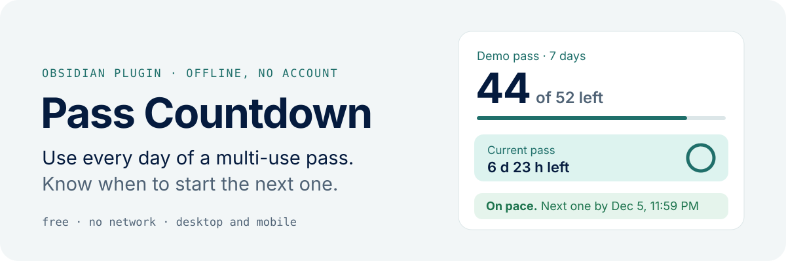
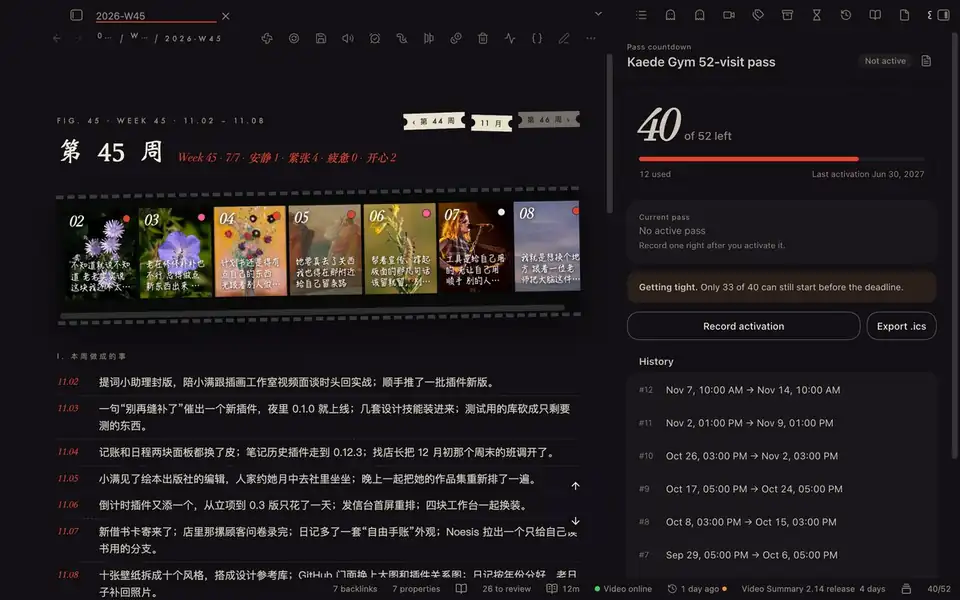
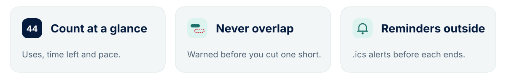
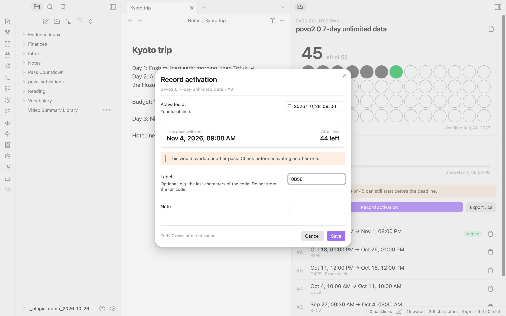
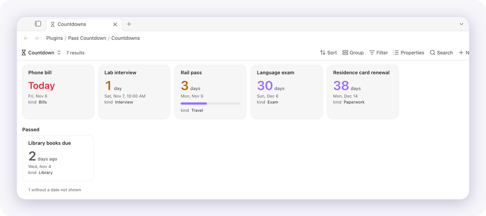
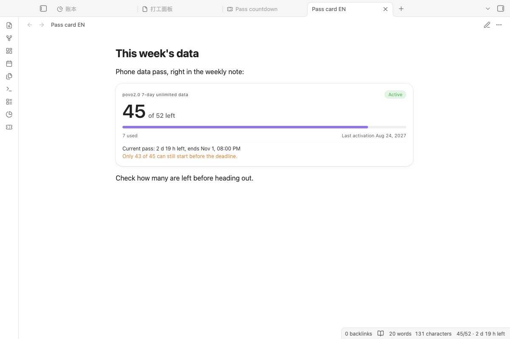

<p align="right"><a href="README.zh.md">中文</a> · <a href="README.ja.md">日本語</a></p>

<p align="center"><picture><source media="(prefers-color-scheme: dark)" srcset="assets/readme/icon-dark.svg"></picture></p>

<picture>
  <source media="(prefers-color-scheme: dark)" srcset="assets/readme/hero-dark.svg">
  
</picture>

<p align="center"><a href="https://community.obsidian.md/plugins/pass-countdown"><b>Install from Obsidian</b></a></p>



<picture>
  <source media="(prefers-color-scheme: dark)" srcset="assets/readme/cards-dark.svg">
  
</picture>

## Start in three steps

1. Install **Pass Countdown** from *Settings → Community plugins → Browse* and enable it, then click the ticket icon in the left ribbon.
2. Open **Settings → Pass Countdown** and set the name, total uses, days per pass and the deadline.
3. Right after you activate a pass, click **Record activation** and confirm the start time before saving.

No pass yet? Click **Load a sample** in the empty panel.

**Needs** Obsidian <!-- DOCS-SYNC:START min -->1.10<!-- DOCS-SYNC:END --> or later, desktop or mobile. **Costs** nothing: no account, no key, no network.

Something not working? [Copy a fix-it prompt](docs/troubleshooting.md) for your AI assistant.

## Everything else

<details>
<summary><b>First run, step by step</b></summary>

1. Install and enable **Pass Countdown** and click the ticket icon in the left ribbon.
2. With no records yet, click **Load a sample** to see the countdown, ring and pace with one made-up pass. It is never exported or reminded about, and **Remove sample** deletes it.
3. Open **Settings → Pass Countdown** and set the name, total uses, days per pass and the deadline.
4. Right after you activate a pass, click **Record activation** and confirm the start time before saving.

</details>

<details>
<summary><b>Every feature</b></summary>



*Before you save, the dialog shows when the pass will end, how many will be left, and whether it would overlap the running one.*

- **Activation records.** Some prepaid bundles give a number of uses, each lasting a fixed time, with a last date to activate them, and do not tell you how many you have used. Record each activation and the panel calculates the remaining uses.
- **Overlap warning:** shows when a new pass would run alongside the current one, and the pace you need to use them all before the deadline.
- **Reminds you** inside Obsidian and through calendar alerts (.ics) before a pass ends.
- **Panel:** uses left, time left on the current pass, days to the deadline, and **pace:** the latest moment to start the next pass if you want to use every one back to back. Once that has passed, it tells you how many can still fit.
- **Status bar:** `47/52 · 3 d 4 h left`.
- **Calendar reminders.** Export an `.ics` file with one event per pass and alerts before it ends (12 h, 1 h and at the end by default) for Apple Calendar, Google Calendar or Outlook.
- **Reminders inside Obsidian,** once when the running pass is about to end and once when the latest start that still fits every pass is near.
- **Countdown view for Bases.** In any base, switch the view to *Countdown*: one card per note with the days left until a date property (a deadline, an exam, a visa renewal), soonest first by default, with the ones that have passed below. Your own base sort is preserved. Pick a start property to see how far along each one is. With Bases turned off nothing changes.
- **Markdown report** of every activation, **import** from notes with `activated_at` / `expires_at` frontmatter, and **edit** a record if you typed the wrong start time.

<picture>
  <source media="(prefers-color-scheme: dark)" srcset="assets/readme/bases-dark.png">
  
</picture>



*A `pass-countdown` code block shows the same count inside any note. It updates every minute.*

The plugin started with a Japanese mobile data bundle (52 uses of 7-day unlimited data, to be activated by 24 August 2027), and works for any pass of the same shape: gym visits that expire, ticket books, trial periods.

</details>

<details>
<summary><b>Where your data goes and what the plugin touches</b></summary>

| | |
|---|---|
| Obsidian | 1.10 or later, desktop and mobile (1.8.7–1.9.x use 1.4.1) |
| The plugin | Free, MIT licence |
| Network | None. The plugin makes no network requests and needs no account or key. |

Nowhere. Records live in this plugin's `data.json` in your vault; the report and the `.ics` file are written where you choose. Store a short label if you need one, never the full prepaid code.

- **Reads** its own `data.json`; once, on a first start with no data, the `data.json` of the older tracker it grew out of (`povo-7day-tracker`), if that exists; the frontmatter of notes in the folder you name when you run an import; and date and display properties of notes in the current base when you use its Countdown view.
- **Writes** its own `data.json`, and, only when you export, the report note and the `.ics` file at the paths in settings (`Pass Countdown/report.md` and `Pass Countdown/reminders.ics` by default). Both paths are inside the vault, and an existing file there is replaced. The **Insert pass card into the current note** command inserts a code block at the cursor or replaces the selection.
- **Never** makes network requests, uses the clipboard, runs other programs, or reads or writes outside the vault.

</details>

<details>
<summary><b>Install by hand, and an example setup</b></summary>

**From Obsidian:** Settings → Community plugins → Browse, install and enable **Pass Countdown** from the directory. [PKMer automatically syncs the official directory](https://pkmer.cn/Pkmer-Docs/00-%E5%85%B3%E4%BA%8E/pkmer%E7%A4%BE%E5%8C%BAfaq/).

**Manually:** download `main.js`, `manifest.json` and `styles.css` from the [latest release](https://github.com/Rexxall/obsidian-pass-countdown/releases/latest) into `<vault>/.obsidian/plugins/pass-countdown/`, reload Obsidian and enable the plugin.

**Checking a download:** from 1.4.1 on, GitHub Actions builds the release files and signs where they came from. Check one with `gh attestation verify main.js --repo Rexxall/obsidian-pass-countdown`.

**Example: povo2.0 7-day data (52 uses).** This is the default setup: 52 uses, 7 days each, deadline `2027-08-24T23:59:00+09:00`. Check your own purchase for the exact terms.

</details>

<details>
<summary><b>How it works</b></summary>

- Times are stored in UTC and shown in your local time, so travelling or a different system time zone does not shift a pass.
- **Deadline** means, by default, the last moment a pass can be *activated*. A pass started just before the deadline still runs its full length. If your passes must also *end* by the deadline, switch *The deadline is* in settings: every date then moves one pass length earlier.
- *Latest next start* = deadline − (uses left − 1) × days per pass. *Pace* turns orange when not every remaining pass can still be started in time.

</details>

<details>
<summary><b>Limits</b></summary>

- One pass type per vault.
- Reminders reach your phone through the calendar you import the `.ics` into; re-export after recording new passes.
- In-app reminders only appear while Obsidian is open.

</details>

<details>
<summary><b>Development and changelog</b></summary>

```bash
npm install
npm run build
npm test   # end times, pace, overlap, .ics, report escaping, import, editing, reminders, migration
```

`styles.css` is generated: edit `styles/plugin.css` and run `npm run styles`. For CI, releases and reporting issues, see [CONTRIBUTING.md](CONTRIBUTING.md).

**1.5.0:** a *Countdown* view for Bases: days left until a date property, one card per note. Needs Obsidian <!-- DOCS-SYNC:START min -->1.10<!-- DOCS-SYNC:END -->.

**1.4.0:** no findings left in the community directory's review, with the same look. 

**1.3.0:** a sample pass for a new panel, the interface language read with Obsidian's `getLanguage()`, and a README in English and Chinese. Full history in [CHANGELOG.md](CHANGELOG.md).

</details>

MIT License
