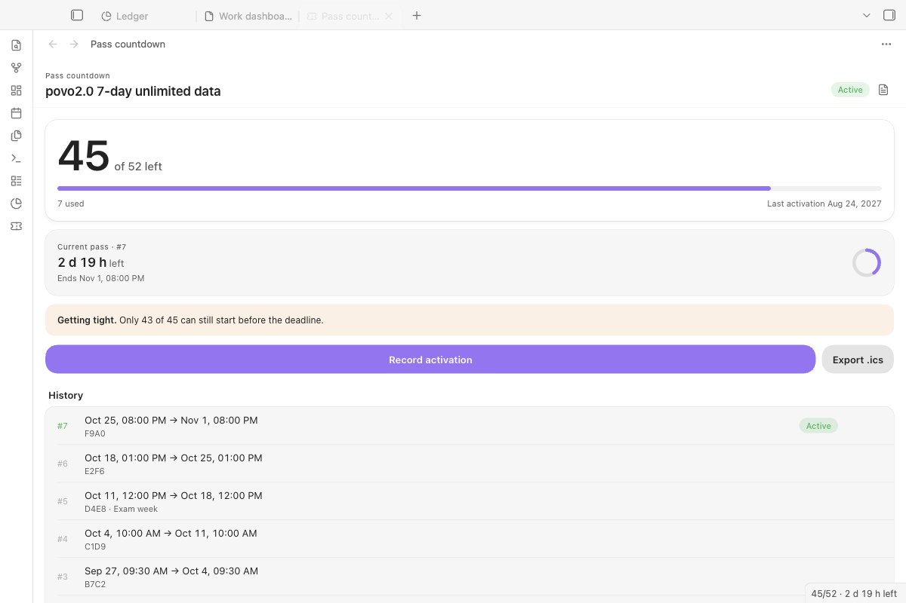

<div align="center">

# Pass Countdown

**Count down a multi-use pass with a deadline: see uses left and time left on the running pass, and know the latest moment to start the next one.**

[中文说明 →](README.zh.md) · [日本語](#日本語)



</div>

## What it does

- **Keeps count for you.** Some prepaid bundles give a number of uses, each lasting a fixed time, with a last date to activate them, and do not tell you how many you have used. Record each activation and the panel does the rest.
- **Warns before you waste one:** an overlap warning if a new pass would run alongside the current one, and the pace you need to use them all before the deadline.
- **Reminds you** inside Obsidian and through calendar alerts (.ics) before a pass ends.

The plugin started with a Japanese mobile data bundle (52 uses of 7-day unlimited data, to be activated by 24 August 2027), and works for any pass of the same shape: gym visits that expire, ticket books, trial periods.

## Start here

1. Install and enable **Pass Countdown**, then click the ticket icon in the left ribbon.
2. With no records yet, click **Load a sample** to see the countdown, ring and pace with one made-up pass. It is never exported or reminded about, and **Remove sample** deletes it.
3. In **Settings → Pass Countdown**, set the name, total uses, days per pass and the deadline.
4. Right after you activate a pass, click **Record activation**.

## What it needs and what it costs

| | |
|---|---|
| Obsidian | 1.8.7 or later, desktop and mobile |
| The plugin | Free, MIT licence |
| Network | None. The plugin makes no network requests and needs no account or key. |

## Where your data goes

Nowhere. Records live in this plugin's `data.json` in your vault; the report and the `.ics` file are written where you choose. Store a short label if you need one, never the full prepaid code.

## Features


*Before you save, the dialog shows when the pass will end, how many will be left, and whether it would overlap the running one.*

- **Panel:** uses left, time left on the current pass, days to the deadline, and **pace**: the latest moment to start the next pass if you want to use every one back to back. Once that has passed, it tells you how many can still fit.
- **Status bar:** `47/52 · 3 d 4 h left`.
- **Calendar reminders.** Export an `.ics` file with one event per pass and alerts before it ends (12 h, 1 h and at the end by default) for Apple Calendar, Google Calendar or Outlook.
- **Reminders inside Obsidian,** once when the running pass is about to end and once when the latest start that still fits every pass is near.
- **Markdown report** of every activation, **import** from notes with `activated_at` / `expires_at` frontmatter, and **edit** a record if you typed the wrong start time.


*A `pass-countdown` code block shows the same count inside any note. It updates every minute.*

## Install

**From Obsidian (once listed):** Settings → Community plugins → Browse, search for **Pass Countdown**.

**Manually:** download `main.js`, `manifest.json` and `styles.css` from the latest release into `<vault>/.obsidian/plugins/pass-countdown/`, reload Obsidian and enable the plugin.

**Example: povo2.0 7-day data (52 uses).** This is the default setup: 52 uses, 7 days each, deadline `2027-08-24T23:59:00+09:00`. Check your own purchase for the exact terms.

## How it works

- Times are stored in UTC and shown in your local time, so travelling or a different system time zone does not shift a pass.
- **Deadline** means, by default, the last moment a pass can be *activated*. A pass started just before the deadline still runs its full length. If your passes must also *end* by the deadline, switch *The deadline is* in settings: every date then moves one pass length earlier.
- *Latest next start* = deadline − (uses left − 1) × days per pass. *Pace* turns orange when not every remaining pass can still be started in time.

```bash
npm install
npm run build
npm test   # end times, pace, overlap, .ics, report escaping, import, editing, reminders, migration
```

`styles.css` is generated: edit `styles/plugin.css` and run `npm run styles`.

## Known limits

- One pass type per vault.
- Reminders reach your phone through the calendar you import the `.ics` into; re-export after recording new passes.
- In-app reminders only appear while Obsidian is open.

## Changelog

**1.3.0:** a sample pass for a new panel, the interface language read with Obsidian's `getLanguage()`, and a README in English and Chinese. Full history in [CHANGELOG.md](CHANGELOG.md).

## License

MIT

---

## 日本語

「N 回分・1 回 D 日間・有効化の期限あり」の回数券を数えるプラグインです。残り回数、今の回の残り時間、すべて使い切るための次回開始の最終時刻を表示し、まだ有効な回と重なると警告します。Obsidian 内の通知と、カレンダー用の .ics 書き出しに対応。通信は一切行わず、データは保管庫の中だけに保存されます。コード全体は保存しないでください。
