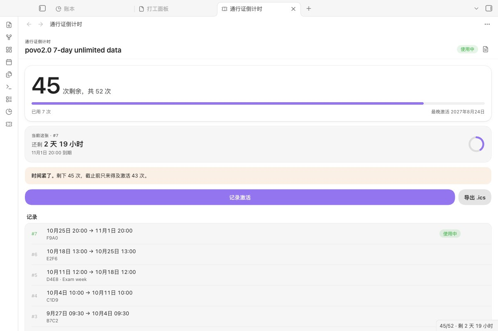
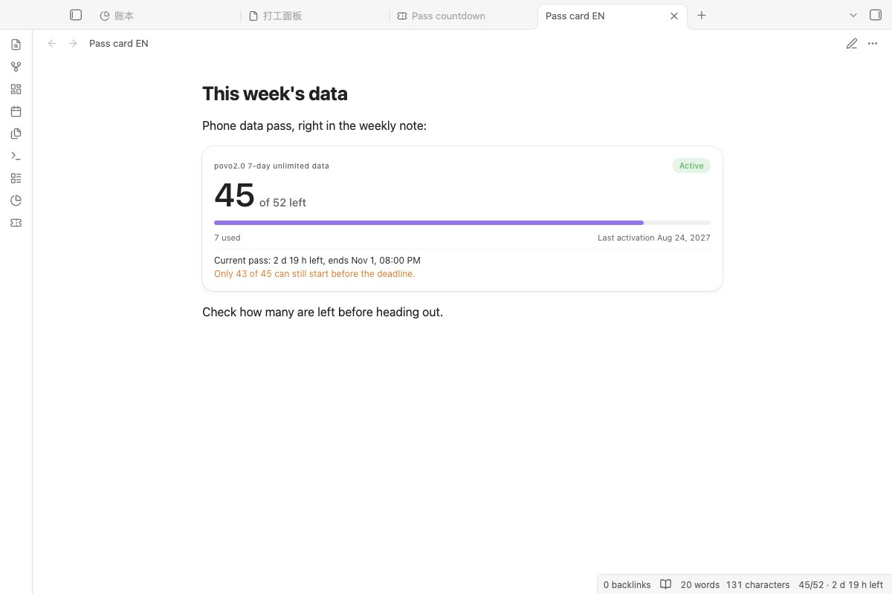

# Pass Countdown（多次券倒数）

**给有期限的多次券倒数：还剩几次、这一张还剩多久、最晚什么时候必须开下一张。**

[English →](README.md)

## 能做什么

- **替你记次数。** 有些预付套餐是“N 次、每次 D 天、某天前必须激活”，却查不到用了几次。每次激活记一笔，剩下的交给面板。
- **防止浪费：** 新的一张会和正在用的重叠时提醒你，并算出想在期限前全部用完需要的节奏。
- **到期前提醒，** 在 Obsidian 里提醒，也能导出日历提醒（.ics）。

做这个插件的起因是日本 povo2.0 的 7 天无限流量 52 次券（2027 年 8 月 24 日前激活）。同样形状的东西都能用：会过期的健身次卡、回数券、试用期。

## 从这里开始

1. 安装并启用 **Pass Countdown**，点左侧栏的票券图标。
2. 还没有记录时，点 **载入示例**，用一张虚构的券看看倒计时、圆环和节奏。示例不会被导出，也不会提醒；点 **删除示例** 一键删掉。
3. 在 **设置 → Pass Countdown** 里填名称、总次数、每张几天和截止时间。
4. 每次激活后马上点 **记录激活**。

## 需要什么、花多少钱

| | |
|---|---|
| Obsidian | 1.8.7 或更高，电脑和手机都能用 |
| 插件本身 | 免费，MIT 许可 |
| 联网 | 不联网。插件不发任何网络请求，不需要账号和密钥。 |

## 数据去哪里

哪儿也不去。记录在库里插件的 `data.json` 里，报告和 `.ics` 文件写在你指定的位置。需要的话只存一个简短标签，不要存完整的兑换码。

## 功能

*保存前会显示这张什么时候到期、之后还剩几次，以及会不会和正在用的重叠。*

- **面板：** 剩余次数、当前这张还剩多久、离截止还有几天，以及 **节奏**：想连续用完，最晚什么时候开下一张；已经来不及时，显示还能用上几张。
- **状态栏：** `47/52 · 剩 3 天 4 小时`。
- **日历提醒。** 导出 `.ics`，每张券一个事件，到期前提醒（默认 12 小时、1 小时和到期时），可导入苹果日历、Google 日历或 Outlook。
- **Obsidian 内提醒，** 当前这张快到期时提醒一次，“最晚开下一张”的时间临近时再提醒一次。
- **Markdown 报告：** 可以从带 `activated_at` / `expires_at` 的笔记导入，记错时间可以编辑。

*在任意笔记里插入 `pass-countdown` 代码块，就能显示同样的卡片，每分钟更新。*

## 安装

**在 Obsidian 里（上架后）：** 设置 → 第三方插件 → 浏览，搜索 **Pass Countdown**。PKMer 会自动同步官方目录。

**手动：** 从最新版本下载 `main.js`、`manifest.json`、`styles.css`，放进 `<库>/.obsidian/plugins/pass-countdown/`，重新加载后启用。

**例子：povo2.0 7 天流量（52 次）。** 这就是默认设置：52 次，每次 7 天，截止 `2027-08-24T23:59:00+09:00`。具体条款以你自己的购买记录为准。

## 原理

- 时间按 UTC 保存、按本地时间显示，出差或改系统时区都不会让券错位。
- **截止时间** 默认指最后一次可以*激活*的时刻；截止前刚开的券照样用满整段。如果券也必须在截止前*用完*，在设置里改“截止时间是指”，所有时间会提前一张券的长度。
- *最晚开下一张* = 截止时间 −（剩余次数 − 1）× 每张天数。来不及全部开完时，“节奏”变橙色。

## 已知限制

- 一个库只管一种券。
- 手机上的提醒靠导入 `.ics` 的日历；记了新的激活后要重新导出。
- Obsidian 内的提醒只在 Obsidian 打开时出现。

## 更新记录

**1.4.0：** 社区目录的自动审查不再有提示，外观不变。

**1.3.0：** 新面板可以载入示例；界面语言改用 Obsidian 的 `getLanguage()` 判断；README 分中英文两份。完整记录见 [CHANGELOG.md](CHANGELOG.md)。

## 许可

MIT
